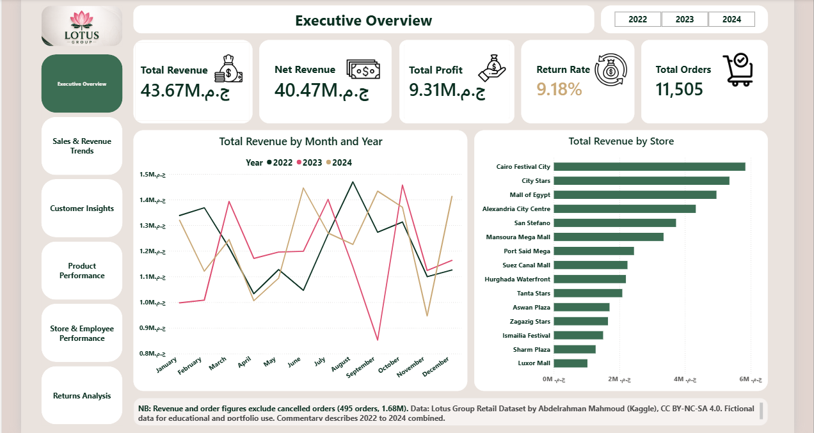
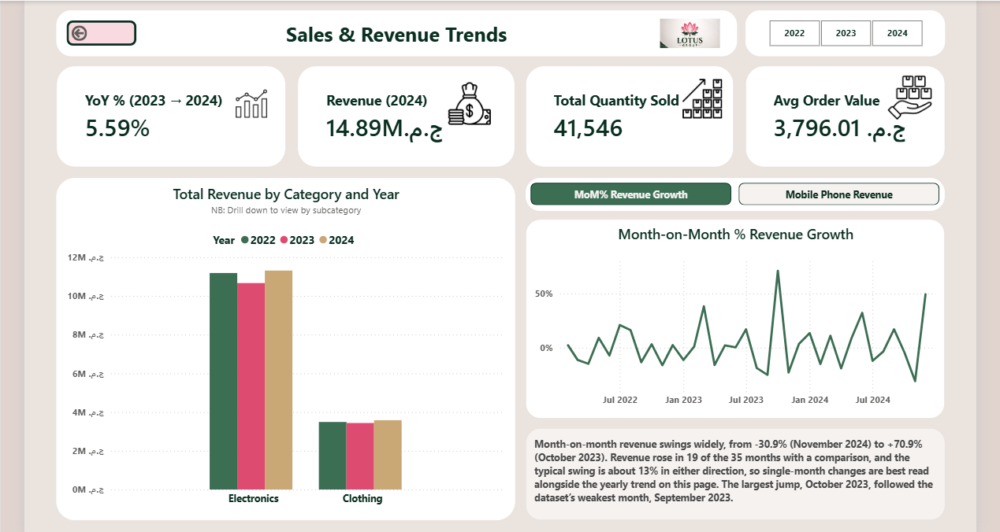
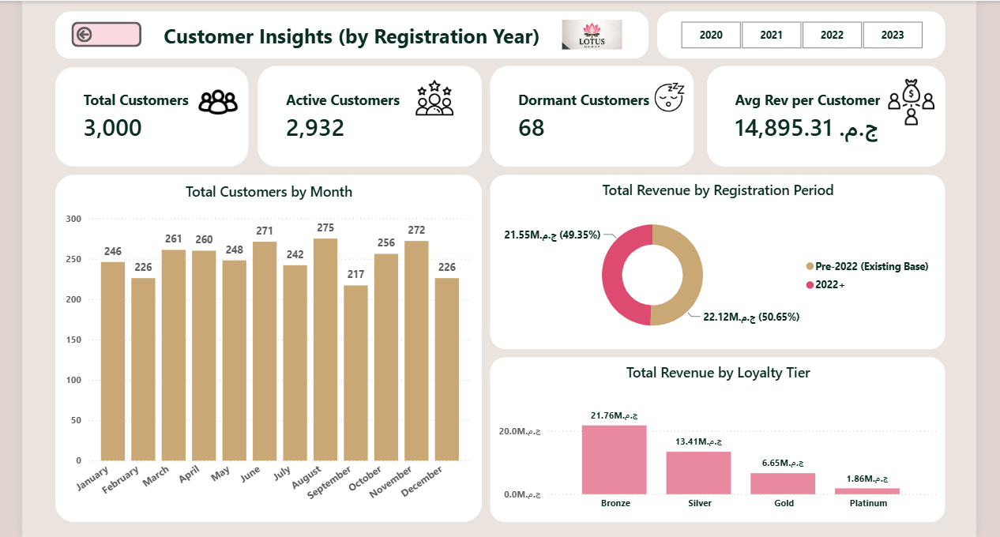
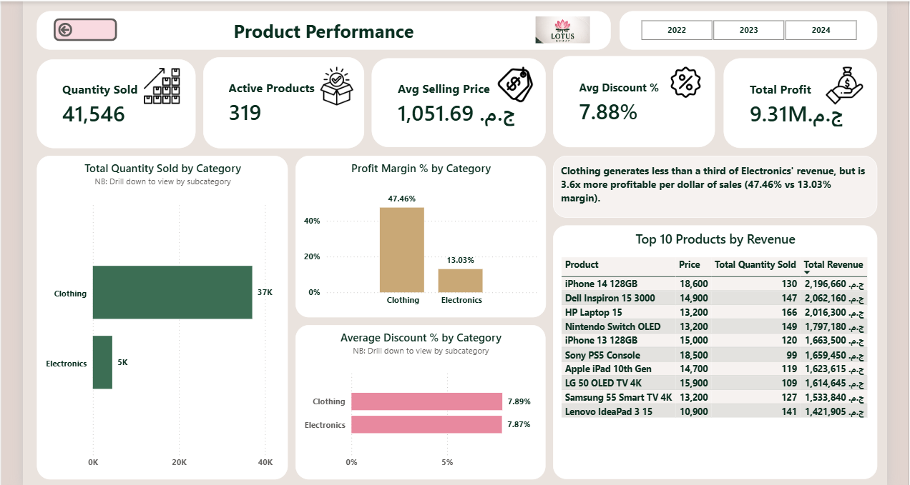
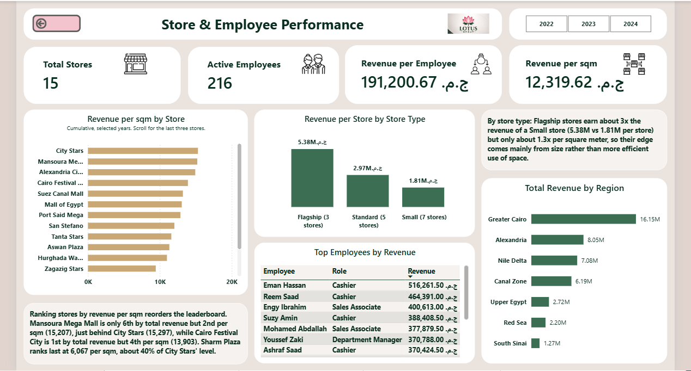
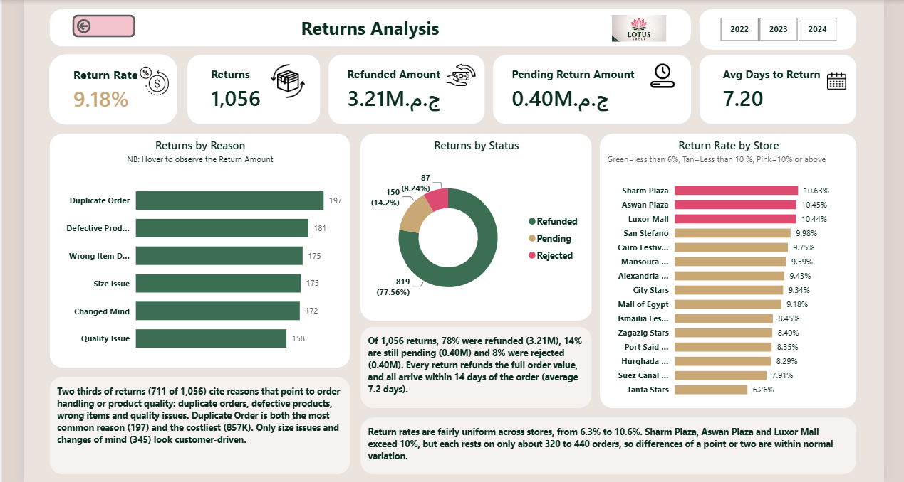

# Lotus Group Retail Dashboard (Power BI)

A six-page Power BI report built on a fictional Egyptian retail dataset: messy source files cleaned in Power Query, modelled as a star schema, and analysed with DAX measures covering revenue, customers, products, stores, employees and returns.

[](https://app.powerbi.com/view?r=eyJrIjoiN2UyNzI3ZTItYTVlZC00ZDdiLWJkMTEtZjE1YzMwN2M0Yjk4IiwidCI6Ijk0MWJiZjVmLWYyYzAtNDg3NS1hMjRjLTY5MDc4NjVkMjUxYSIsImMiOjh9&embedImagePlaceholder=true&pageName=b74fe3075e178bb2e04a)

**[Open the live interactive report](https://app.powerbi.com/view?r=eyJrIjoiN2UyNzI3ZTItYTVlZC00ZDdiLWJkMTEtZjE1YzMwN2M0Yjk4IiwidCI6Ijk0MWJiZjVmLWYyYzAtNDg3NS1hMjRjLTY5MDc4NjVkMjUxYSIsImMiOjh9&embedImagePlaceholder=true&pageName=b74fe3075e178bb2e04a)**

## Overview

The source data is deliberately imperfect, so most of the work was the full BI workflow rather than chart-building:

- **Power Query:** deduplication, type conversion, column splits, text trimming, null and empty-string handling, appending two order tables, merging returns
- **Data model:** star schema with 5 dimension tables and 2 fact tables, a proper date table, and one inactive relationship used through `USERELATIONSHIP`
- **DAX:** 30+ measures organised in display folders, including time intelligence, returns, customers and store efficiency
- **Report design:** six pages, a custom theme built from the Lotus Group logo colours, synced year slicers, a bookmark toggle, drill-down charts and conditional formatting

Full write-up: [`Docs/lotus-retail-dashboard-case-study.md`](Docs/lotus-retail-report-case-study.md)

## Dashboard pages

| Page | Question it answers |
|---|---|
| Executive Overview | How is the business performing overall? |
| Sales & Revenue Trends | How does revenue move over time, and what drove the 2023 dip? |
| Customer Insights | Who is buying, and how much revenue comes from existing vs. newer customers? |
| Product Performance | What sells, at what margin and discount? |
| Store & Employee Performance | Which stores use their space best, and who generates the revenue? |
| Returns Analysis | How often are orders returned, why, and what happens to the refund? |

## Key findings

All figures exclude cancelled orders (495 orders, 1.68M), 2022 to 2024 combined.

- Revenue was 43.67M with a 21.3% profit margin; Net Revenue after refunds was 40.47M.
- Revenue fell 3.9% in 2023 and recovered 5.6% in 2024. The 2023 decline was concentrated in Mobile Phones (-24%), whose drop exceeded the company's entire net decline.
- Clothing earns a 47.5% margin against Electronics' 13.0%, on less than a third of the revenue.
- Ranking stores by revenue per square metre reorders the leaderboard compared with total revenue.
- 9.18% of orders were returned. Every return refunds the full order, and all arrive within 14 days.



## More pages









## Data preparation highlights

- Removed 50 duplicate customer rows (3,050 to 3,000).
- Found that blank emails were empty strings, not nulls, after a null-based flag returned TRUE for every row. Fixed the check and added a `has_email` flag.
- Replaced 632 missing `employee_id` values with an "Unknown" key and added a matching placeholder row to `dim_employees`, so those orders stay in revenue totals.
- Traced a merge that dropped a table from 12,000 to 632 rows back to a stray filter step, and rebuilt it.
- Excluded cancelled orders from all revenue, order and customer measures after finding they carried 4% of revenue.

## Repository structure

```
[repo-name]/
├── README.md
├── Report/
│   ├── Lotus-Group-Retail-Report.pbix
│   └── Lotus_Group_Theme.json
├── Data/
│   └── (the 9 source CSV files)
├── Docs/
│   └── lotus-retail-dashboard-case-study.md
└── Images/
    └── (exported page screenshots)
```

## How to open

1. Install [Power BI Desktop](https://powerbi.microsoft.com/desktop/) (Windows).
2. Open `Report/Lotus-Group-Retail-Report.pbix`. The custom theme (`Report/Lotus_Group_Theme.json`) is already applied inside it; it's included in case you want to reuse it.
3. If Power BI asks for the data location, point it at the `Data/` folder (Home > Transform data > Data source settings).

## Data source and licence

Data: *Lotus Group Retail Dataset* by Abdelrahman Mahmoud (Kaggle),
https://www.kaggle.com/datasets/abdelrahmanmahmoud22/lotus-group-retail-star-schema-bi

Licensed under [CC BY-NC-SA 4.0](https://creativecommons.org/licenses/by-nc-sa/4.0/).

Changes: cleaned and transformed in Power Query (deduplication, type conversion, column splits, trimming, appended order tables, merged returns), modelled as a star schema, with DAX measures and visuals added.

The dataset is fictional and was generated with AI assistance, per its Data Card. Nothing in this report reflects a real business, and no real-world causes are claimed for any pattern. The material here is shared under the same licence, for non-commercial use.

## Author

Kobina Kwae Nyarko-Yawson ([KobbyYawson](https://github.com/KobbyYawson)) | [www.linkedin.com/in/kobina-nyarko-yawson]
